# Domain model

The cloud PostgreSQL schema lives in `packages/database/prisma/schema.prisma`. Tables and
columns are snake_case; Prisma fields are camelCase. The location hub's SQLite schema (Phase 5)
mirrors the operational subset.

**Migration status:** ✅ migrated · ⏳ designed, migrates in the phase shown.

| Area      | Entity                                                                                                                            | Status                  |
| --------- | --------------------------------------------------------------------------------------------------------------------------------- | ----------------------- |
| Tenancy   | Restaurant, Location                                                                                                              | ✅ 0001                 |
| Identity  | User, Role, Permission, RolePermission, UserRole, RefreshToken, Employee                                                          | ✅ 0001                 |
| Devices   | Device                                                                                                                            | ✅ 0001                 |
| Audit     | AuditLog                                                                                                                          | ✅ 0001                 |
| Catalog   | Category, Product, ProductVariant, ModifierGroup, Modifier, ProductModifierGroup, KitchenStation, ProductStation, LocationProduct | ✅ 0002                 |
| Catalog   | Tax, ProductTax, Discount                                                                                                         | ⏳ Phase 2              |
| Floor     | TableSection, Table                                                                                                               | ⏳ Phase 2              |
| Orders    | Order, OrderItem, OrderItemModifier, OrderStatusHistory, OrderDiscount                                                            | ⏳ Phase 2              |
| Payments  | PaymentMethod, Payment                                                                                                            | ⏳ Phase 3              |
| Cash      | Shift, CashRegister, CashTransaction                                                                                              | ⏳ Phase 3              |
| Kitchen   | KitchenTicket, KitchenTicketItem                                                                                                  | ⏳ Phase 4              |
| Sync      | ProcessedOperation, ChangeLog (cloud); SyncOperation, SyncState (hub)                                                             | ⏳ Phase 6              |
| Customers | Customer, Address                                                                                                                 | ⏳ Phase 7              |
| Inventory | InventoryItem, Recipe, StockMovement                                                                                              | ⏳ module boundary only |

## ERD

```mermaid
erDiagram
  Restaurant ||--o{ Location : has
  Restaurant ||--o{ User : employs
  Restaurant ||--o{ Role : defines
  Restaurant ||--o{ Employee : has
  Restaurant ||--o{ Category : owns
  Restaurant ||--o{ Product : owns
  Restaurant ||--o{ ModifierGroup : owns
  Restaurant ||--o{ KitchenStation : owns
  Restaurant ||--o{ Tax : defines

  Role ||--o{ RolePermission : grants
  Permission ||--o{ RolePermission : "granted by"
  User ||--o{ UserRole : holds
  Role ||--o{ UserRole : "assigned via"
  Location |o--o{ UserRole : "scopes (null = all)"
  User ||--o{ RefreshToken : "sessions"
  User |o--o| Employee : "back-office link"

  Location ||--o{ Device : registers
  Location ||--o{ KitchenStation : "has (optional scope)"
  Location ||--o{ LocationProduct : "availability / price override"
  Location ||--o{ TableSection : has
  TableSection ||--o{ Table : contains

  Category ||--o{ Product : groups
  Product ||--o{ ProductVariant : "sizes"
  Product ||--o{ ProductModifierGroup : offers
  ModifierGroup ||--o{ ProductModifierGroup : "attached to"
  ModifierGroup ||--o{ Modifier : contains
  Product ||--o{ ProductStation : "prepared at"
  KitchenStation ||--o{ ProductStation : prepares
  Product ||--o{ LocationProduct : "per location"
  Product ||--o{ ProductTax : taxed
  Tax ||--o{ ProductTax : applies

  Location ||--o{ Order : receives
  Customer |o--o{ Order : places
  Order ||--o{ OrderItem : contains
  OrderItem ||--o{ OrderItemModifier : "with"
  Order ||--o{ OrderStatusHistory : "transitions"
  Order ||--o{ OrderDiscount : "discounted by"
  Order ||--o{ Payment : "paid by"
  PaymentMethod ||--o{ Payment : "method"
  Order ||--o{ KitchenTicket : "routed to"
  KitchenStation ||--o{ KitchenTicket : queues
  KitchenTicket ||--o{ KitchenTicketItem : lists
  OrderItem ||--o{ KitchenTicketItem : "prepared as"

  Location ||--o{ Shift : runs
  CashRegister ||--o{ Shift : "used in"
  Shift ||--o{ CashTransaction : records
  Customer ||--o{ Address : has

  InventoryItem ||--o{ Recipe : "used in"
  Product ||--o{ Recipe : "consumes"
  InventoryItem ||--o{ StockMovement : moves
```

## Entity notes

**Restaurant**: tenant root. `currencyCode` is immutable after provisioning, because every stored
amount is in its minor units. `timezone` is used for restaurant-level reports.

**Location**: a branch. `code` is unique per restaurant and prefixes hub-generated order numbers.
`taxInclusive` says whether menu prices include tax. `onlineOrderingState` is one of
`OPEN/PAUSED/CLOSED/OFFLINE`.

**User / Role / Permission / UserRole**: permission keys are defined in code
(`@pos/shared-types` `PERMISSIONS`) and upserted into `permissions` at API start. Roles are
per-restaurant. A `UserRole` with `locationId = null` applies to all locations. Effective
permissions are resolved by `resolvePermissions()` in `@pos/domain`. Uniqueness of (user, role,
location) is enforced in the service layer, because Postgres treats NULL location ids as
distinct.

**RefreshToken**: stores only a SHA-256 hash. `familyId` groups the rotations of one login.
Presenting a rotated token revokes the whole family.

**Employee**: staff who operate POS/KDS, with an argon2id PIN hash for offline PIN login on the
hub (Phase 2/5). Optionally linked to a `User`.

**Device**: POS, KDS, printer, kitchen display, customer display or gateway. `metadata` holds
non-secret descriptive data only.

**AuditLog**: append-only. `metadata` is redacted (passwords, tokens, PINs, card data) before
insert. It records `actorType/actorId`, `source` (POS/KDS/WEBSITE/ADMIN/HUB/SYSTEM) and
`requestId`. It has no foreign keys, so the audit trail survives other deletions.

**Catalog** (Phase 1):

- `Category`: sortable, localized, archivable.
- `Product`: belongs to one category. Base `price` is in minor units, `sku` is optional, and it
  has localized name/description, `isActive` and `archivedAt`.
- `ProductVariant`: sizes or options with their own absolute `price`. When a product has
  variants, one must be chosen.
- `ModifierGroup`: `minSelect` / `maxSelect` (`maxSelect = null` means unlimited) and localized
  names. `Modifier` has a `priceDelta` (minor units, may be 0) and `isDefault`.
- `ProductModifierGroup`: attaches groups to products with a sort order and optional per-product
  min/max overrides.
- `KitchenStation` (Kitchen, Grill, Fryer, Bar, Dessert, …) is defined **per restaurant**
  with a unique `code`; each location's KDS screens subscribe to the stations they serve.
  `ProductStation` is many-to-many, and an order item is routed to every live station its
  product is assigned to.
- CHECK constraints (migration 0003) guard non-negative prices/deltas/overrides and valid
  min/max selection bounds at the database level. Prisma does not model them, and they cause no
  drift.
- `LocationProduct`: per-location `isAvailable` (the "86" switch) and an optional
  `priceOverride`. A missing row means available at the base price.

Orders store **snapshots** (name, prices, modifiers) so that later menu edits never change
historical orders.
