# Domain model

The cloud PostgreSQL schema lives in `packages/database/prisma/schema.prisma`. Tables and
columns are snake_case; Prisma fields are camelCase. The location hub's SQLite schema (Phase 5)
mirrors the operational subset.

**Migration status:** ✅ migrated · ⏳ designed, migrates in the phase shown.

| Area      | Entity                                                                                                                            | Status                             |
| --------- | --------------------------------------------------------------------------------------------------------------------------------- | ---------------------------------- |
| Tenancy   | Tenant, Location                                                                                                                  | ✅ 0001                            |
| Identity  | User, Role, Permission, RolePermission, UserRole, RefreshToken, Employee                                                          | ✅ 0001                            |
| Identity  | Account (the login; synced to hubs)                                                                                               | ✅ Phase E1                        |
| Tenancy   | Organization, OrganizationMember (cloud)                                                                                          | ✅ Phase E1                        |
| Modules   | TenantEntitlement, FeatureOverride                                                                                                | ✅ Phase M2                        |
| Branding  | TenantBranding, TenantFile                                                                                                        | ✅ Phase M3                        |
| Devices   | Device                                                                                                                            | ✅ 0001                            |
| Audit     | AuditLog                                                                                                                          | ✅ 0001                            |
| Catalog   | Category, Product, ProductVariant, ModifierGroup, Modifier, ProductModifierGroup, KitchenStation, ProductStation, LocationProduct | ✅ 0002                            |
| Catalog   | Tax, ProductTax, Discount                                                                                                         | ✅ 0004 (+ 0005 CHECK constraints) |
| Retail    | ProductOption, ProductOptionValue, ProductVariantOptionValue, ProductBarcode, ProductImage                                        | ✅ Phase M5                        |
| Floor     | TableSection, Table (`DiningTable` in Prisma)                                                                                     | ✅ 0004                            |
| Orders    | Order, OrderItem, OrderItemModifier, OrderTax, OrderDiscount, OrderStatusHistory, OrderCounter                                    | ✅ 0004 (+ 0005)                   |
| Payments  | PaymentMethod, Payment                                                                                                            | ✅ Phase 3                         |
| Payments  | PaymentProviderAccount; PaymentProviderSecret (cloud)                                                                             | ✅ Phase M8                        |
| Cash      | Shift, CashRegister, CashTransaction                                                                                              | ✅ Phase 3                         |
| Kitchen   | KitchenTicket, KitchenTicketItem                                                                                                  | ✅ Phase 4                         |
| Sync      | SyncOperation, HubState, InboundOrder (hub); ProcessedOperation, ChangeLog (cloud)                                                | ✅ Phases 5–8                      |
| Online    | WebOrderCounter (cloud); website fields on Order and Location                                                                     | ✅ Phase 7                         |
| Website   | TenantDomain, WebsiteConfig (cloud)                                                                                               | ✅ Phase M7                        |
| Platform  | PlatformUser, PlatformRefreshToken, PlatformAuditLog, PlatformErrorEvent (cloud)                                                  | ✅ Phase M9                        |
| Releases  | Release, TenantReleaseChannel (cloud); `Device.lastVersionAt`                                                                     | ✅ Phase M10                       |
| Reporting | Views `report_sales_orders`, `report_payments`, `report_refunds`, `report_kitchen_tickets` (cloud, not Prisma models)             | ✅ Phase 9                         |
| Customers | Customer, Address (accounts)                                                                                                      | ⏳ deferred (guest checkout only)  |
| Inventory | InventoryItem, Recipe, StockMovement                                                                                              | ⏳ module boundary only            |

## ERD

```mermaid
erDiagram
  Tenant ||--o{ Location : has
  Tenant ||--o{ User : employs
  Organization |o--o{ Tenant : "groups brands"
  Organization ||--o{ OrganizationMember : "has members"
  Account ||--o{ OrganizationMember : "is member"
  Account ||--o{ User : "signs in as (one per brand)"
  Tenant ||--o{ Role : defines
  Tenant ||--o{ Employee : has
  Tenant ||--o{ Category : owns
  Tenant ||--o{ Product : owns
  Tenant ||--o{ ModifierGroup : owns
  Tenant ||--o{ KitchenStation : owns
  Tenant ||--o{ Tax : defines
  Tenant ||--o{ TenantEntitlement : "is entitled to"
  Tenant ||--o{ FeatureOverride : switches
  Location |o--o{ FeatureOverride : "scopes (null = tenant)"
  Device |o--o{ FeatureOverride : "scopes (null = location)"
  Tenant ||--o| TenantBranding : "is branded by"
  Tenant ||--o{ TenantFile : uploads
  TenantFile |o--o{ TenantBranding : "logo / favicon"
  Tenant ||--o{ TenantDomain : "answers on"
  Tenant ||--o| WebsiteConfig : "publishes"

  Role ||--o{ RolePermission : grants
  Permission ||--o{ RolePermission : "granted by"
  User ||--o{ UserRole : holds
  Role ||--o{ UserRole : "assigned via"
  Location |o--o{ UserRole : "scopes (null = all)"
  User ||--o{ RefreshToken : "sessions"
  User |o--o| Employee : "back-office link"

  Location ||--o{ Device : registers
  Location ||--o{ KitchenStation : "has (optional scope)"
  Location ||--o{ LocationProduct : "availability / price override"
  Location ||--o{ TableSection : has
  TableSection ||--o{ Table : contains

  Category ||--o{ Product : groups
  Product ||--o{ ProductVariant : "sizes / combinations"
  Product ||--o{ ProductOption : "axes (Size, Colour)"
  ProductOption ||--o{ ProductOptionValue : values
  ProductVariant ||--o{ ProductVariantOptionValue : "is"
  ProductOptionValue ||--o{ ProductVariantOptionValue : "used by"
  Product ||--o{ ProductBarcode : "scanned by"
  ProductVariant ||--o{ ProductBarcode : "scanned by"
  Product ||--o{ ProductImage : pictures
  TenantFile ||--o{ ProductImage : shows
  Product ||--o{ ProductModifierGroup : offers
  ModifierGroup ||--o{ ProductModifierGroup : "attached to"
  ModifierGroup ||--o{ Modifier : contains
  Product ||--o{ ProductStation : "prepared at"
  KitchenStation ||--o{ ProductStation : prepares
  Product ||--o{ LocationProduct : "per location"
  Product ||--o{ ProductTax : taxed
  Tax ||--o{ ProductTax : applies

  Location ||--o{ Order : receives
  Customer |o--o{ Order : places
  Order ||--o{ OrderItem : contains
  OrderItem ||--o{ OrderItemModifier : "with"
  Order ||--o{ OrderStatusHistory : "transitions"
  Order ||--o{ OrderDiscount : "discounted by"
  Order ||--o{ Payment : "paid by"
  PaymentMethod ||--o{ Payment : "method"
  PaymentProviderAccount |o--o{ PaymentMethod : "processes"
  PaymentProviderAccount |o--o{ Payment : "took"
  PaymentProviderAccount ||--o| PaymentProviderSecret : "sealed secrets (cloud)"
  Device |o--o{ Payment : "kiosk card terminal"
  Order ||--o{ KitchenTicket : "routed to"
  KitchenStation ||--o{ KitchenTicket : queues
  KitchenTicket ||--o{ KitchenTicketItem : lists
  OrderItem ||--o{ KitchenTicketItem : "prepared as"

  Location ||--o{ Shift : runs
  CashRegister ||--o{ Shift : "used in"
  Shift ||--o{ CashTransaction : records
  Customer ||--o{ Address : has

  InventoryItem ||--o{ Recipe : "used in"
  Product ||--o{ Recipe : "consumes"
  InventoryItem ||--o{ StockMovement : moves
```

## Entity notes

**Tenant** ([ADR 0017](adr/0017-tenant-root-and-isolation.md)): the root business entity (a
restaurant, café, supermarket, shop…); every business row belongs to exactly one tenant. `slug` is
unique. `legalName` is optional. `businessType` is text validated against `BusinessType` in
`@pos/shared-types` (`RESTAURANT`, `COFFEE_SHOP`, `SUPERMARKET`, `GROCERY`, `CLOTHING`, `RETAIL`,
`OTHER`); it only picks default configuration. `status` (`ACTIVE`/`SUSPENDED`/`ARCHIVED`) belongs
to the platform operator. `currencyCode` is immutable after provisioning, because every stored
amount is in its minor units; new tenants are in `ILS`. `defaultLocale` is one of
`supportedLocales` (JSON array). How amounts are shown and the digit style are tenant settings
(see **Currency and languages** below).
`timezone` is used for tenant-level reports. `organizationId` (E1) names the organization the tenant is a
brand of, if any. Tenants are created by `provisionTenant` (`@pos/database`), always with a system Owner
role.

**Tenant isolation**: services use a Prisma client scoped to the tenant in scope
(`TenantContext`). It adds the tenant to every filter on a model holding a `tenantId` (and on
`Tenant` by `id`) and refuses writes for another tenant. Child rows without a `tenantId` are reached
through their scoped parent. See ADR 0017.

**Account and Organization** ([ADR 0029](adr/0029-organizations-and-accounts.md), E1):

- `Account` is the login: `email` (stored lowercase, globally unique), the argon2id `passwordHash` and
  `lastTenantId`, the brand signed into last (cloud only; sent to hubs as `null`). One account has at
  most one `User` per tenant (`@@unique([tenantId, accountId])`), so one person signs in once and uses
  every brand they have a user in. `User.email` is a display copy kept equal to the account's, unique
  per tenant; `User` no longer has a password. An account has no `tenantId` and is read only by the
  sign-in and organization services (allowlisted `runUnscoped`). It is synced to hubs with the brand's
  users (snapshot format 9).
- `Organization` (cloud only): `slug` (unique), `nameEn`, `nameAr`, `currencyCode` (every brand of the
  organization uses it; fixed for its lifetime) and `status` (`ACTIVE`/`SUSPENDED`). `Tenant.organizationId`
  is null for a standalone business; on the hub it is a plain column.
- `OrganizationMember` (cloud only; unique per organization and account): the account's `role`
  (`OWNER`, `MANAGER`, `FINANCE`) and the `displayName` its users get in brands that join later. Roles
  map to brand roles of the same name: Owner, Manager and Finance (a built-in role in every tenant with
  `reports.view` and `locations.view`).
- **Linked users:** the users an organization manages, one per member per brand, tenant-wide. They carry
  `User.organizationMemberId`, and the role assignments the organization added carry
  `UserRole.grantedByOrganization`, so ending the membership removes only those. Only
  `OrganizationService` writes them; the brand's staff APIs refuse to change them
  (`USER_MANAGED_BY_ORGANIZATION`). A person's own user in a brand is kept and the organization's role is
  added to it.
- The **organization scope** (`TenantContext` kind `organization`) reads tenant-keyed models across the
  organization's brands and refuses every write; see the ADR.

**Modules** ([ADR 0018](adr/0018-feature-modules.md)): `Feature` (`@pos/shared-types`) lists
the modules; resolution goes platform defaults → business-type defaults → tenant → location →
device, capped by the platform's entitlement. Both tables store the feature as text.

- `TenantEntitlement` (key: tenant + feature) is the platform operator's: `entitled` (without it
  the module is off) and `tenantConfigurable` (without it the tenant's overrides are ignored). No
  row means entitled and configurable.
- `FeatureOverride` is the tenant administrator's `enabled` for the whole tenant, one location, or
  one device (which also names its location). `scope` (`tenant`, `location:<id>`,
  `device:<id>`) makes one override per scope unique on both databases; a check constraint keeps
  it consistent with the ids.

Code asks for capabilities, never for the business type: a lint rule keeps `businessType`
comparisons in `features/defaults.ts`.

**Branding** ([ADR 0019](adr/0019-branding-and-theme.md)): resolution goes MADAR's defaults →
tenant → surface (`login`, `pos`, `kds`, `kiosk`, `website`) → the device's light/dark choice.

- `TenantBranding` (key: tenant; absent until first saved): display names, logo and favicon file
  ids, `#rrggbb` primary/secondary/accent colours, typeface, logo size, theme mode, surface style
  and corner radius, each null to inherit. `surfaces` (JSON) holds the per-surface overrides,
  validated by `surfaceOverridesSchema`. Colours are checked for contrast on save.
- `TenantFile`: a logo, favicon, product picture (M5) or website picture (M7) the tenant uploaded. Immutable; `storageKey`
  (`tenants/<tenantId>/<kind>/<id>.<ext>`, unique, kept inside the tenant's folder by a check
  constraint) names the bytes in the tenant file storage, `contentType` is the type the bytes
  were verified to be (PNG, JPEG, WebP, ICO), `sha256` lets a hub check its copy.

The platform's own brand (MADAR · Powered by JudyTech) is not data: it is `PLATFORM_BRAND` in
`@pos/shared-types`.

**Website** ([ADR 0023](adr/0023-multi-tenant-website.md), cloud only, not in the hub schema):

- `TenantDomain`: a host name the tenant's website answers on. `domain` is stored normalized
  (lower case, punycode, no port or trailing dot; a check constraint), `kind` `SUBDOMAIN`
  (`<slug>.<PLATFORM_WEB_DOMAIN>`, created verified at provisioning) or `CUSTOM`, `status`
  `PENDING`/`VERIFIED`/`FAILED`/`DISABLED`, `isPrimary` (the site's canonical address; one per
  tenant, verified only), a random `verificationToken` for the `_madar-verify` TXT record,
  `verifiedAt`, `lastCheckedAt`. Unique per tenant and name; a partial unique index keeps a name
  VERIFIED for one tenant at most, so pending claims of several tenants may coexist.
- `WebsiteConfig` (key: tenant; absent = MADAR's template for the business type): `draft` and
  `published` JSON, both `@pos/validation` `websiteConfigSchema`, `version` (0 until published, a
  check ties it to `published`), `publishedAt`. Pictures are `TenantFile`s of kind
  `WEBSITE_IMAGE`.

**Currency and languages** ([ADR 0020](adr/0020-currency-and-localization.md)) are tenant
columns, resolved MADAR's defaults → tenant:

- `currencyCode` (ISO 4217, fixed at provisioning, `ILS` by default) with its decimal places from
  ISO 4217, never stored. `currencySymbol` (1–8 characters), `currencyDisplay` (`narrowSymbol`,
  `symbol`, `code`) and `currencyFormatLocale` (one of `FORMAT_LOCALES`) are null to inherit;
  database checks keep the display and the symbol's length valid.
- `defaultLocale`, `supportedLocales` (JSON, includes the default) and `digits` (`latn`, `arab`;
  null inherits Latin).

**Location**: a branch or store. `code` is unique per tenant and prefixes hub-generated order
numbers.
`taxInclusive` says whether menu prices include tax. `onlineOrderingState` is the location's
online-ordering switch (`OPEN/PAUSED/CLOSED`; what customers see is derived, see Online ordering
below), with `openingHours` (JSON weekly windows), `onlineAcceptMinutes`, `onlinePickupEnabled`,
`onlineDeliveryEnabled` and `onlineDeliveryFee`.

**User / Role / Permission / UserRole**: permission keys are defined in code
(`@pos/shared-types` `PERMISSIONS`) and upserted into `permissions` at API start. Roles are
per-tenant. A `UserRole` with `locationId = null` applies to all locations. Effective
permissions are resolved by `resolvePermissions()` in `@pos/domain`. Uniqueness of (user, role,
location) is enforced in the service layer, because Postgres treats NULL location ids as
distinct.

**RefreshToken**: stores only a SHA-256 hash. `familyId` groups the rotations of one login.
Presenting a rotated token revokes the whole family.

**Employee**: staff who operate POS/KDS, with an argon2id PIN hash for offline PIN login on the
hub (Phase 2/5). Linked to a `User`, whose roles the employee signs in with; without one, no PIN
sign-in. Managed in the admin portal (Phase 8).

**Device**: POS, KDS, printer, kitchen display, customer display, kiosk or gateway. `metadata`
holds non-secret descriptive data only. Terminals (POS, KDS, kiosk, customer display; M6,
[ADR 0022](adr/0022-self-service-kiosk.md)) start `PENDING` with `pairingCodeHash` and
`pairingExpiresAt` (a CHECK keeps them together, and only while pending), pair with their hub
(`pairedAt`), and report `lastSeenAt` and `appVersion` (`x-madar-client-version`). Every device,
hubs included, keeps `lastVersionAt`, when it first reported its current version (M10,
[ADR 0026](adr/0026-versions-and-releases.md); a CHECK requires a version with it). A terminal's
credential hash lives on its hub only; a hub's in the cloud. The lifecycle only moves forward:
`PENDING` → `ACTIVE` → `DISABLED`.

**ProcessedOperation** (cloud): the exactly-once ledger of hub pushes (ADR 0012). Refusals keep
the hub's state (`payload`) and, once an administrator settled them, the `resolution`
(`APPLIED_HUB` / `KEPT_CLOUD`), who and when, and a note (ADR 0014).

**AuditLog**: append-only. `metadata` is redacted (passwords, tokens, PINs, card data) before
insert. It records `actorType/actorId`, `source` (POS/KDS/WEBSITE/ADMIN/HUB/SYSTEM) and
`requestId`. It has no foreign keys, so the audit trail survives other deletions.

**Catalog** (Phase 1):

- `Category`: sortable, localized, archivable.
- `Product`: belongs to one category. Base `price` is in minor units, `sku` is optional, and it
  has localized name/description, `isActive` and `archivedAt`.
- `ProductVariant`: sizes or options with their own absolute `price`. When a product has
  variants, one must be chosen.
- `ModifierGroup`: `minSelect` / `maxSelect` (`maxSelect = null` means unlimited) and localized
  names. `Modifier` has a `priceDelta` (minor units, may be 0) and `isDefault`.
- `ProductModifierGroup`: attaches groups to products with a sort order and optional per-product
  min/max overrides.
- `KitchenStation` (Kitchen, Grill, Fryer, Bar, Dessert, …) is defined **per tenant**
  with a unique `code`; each location's KDS screens subscribe to the stations they serve.
  `ProductStation` is many-to-many, and an order item is routed to every live station its
  product is assigned to.
- CHECK constraints (migration 0003) guard non-negative prices/deltas/overrides and valid
  min/max selection bounds at the database level. Prisma does not model them, and they cause no
  drift.
- `LocationProduct`: per-location `isAvailable` (the "86" switch) and an optional
  `priceOverride`. A missing row means available at the base price.

**Retail catalog** ([ADR 0021](adr/0021-retail-catalog-and-barcodes.md), Phase M5):

- `ProductOption` (an axis of one product: Size, Colour, Material…, localized, sortable) and
  `ProductOptionValue` (S, M, L). Deleted, not archived, when removed: order lines keep names.
- `ProductVariantOptionValue` (key: variant + value): which value of each option a variant is.
  A product with options sells combinations, one value of each option, none twice, named after
  the values; a product without options keeps hand-named variants.
- `ProductVariant` also has `sku` (unique in the tenant across products and live variants,
  checked by the service), `cost` (minor units, never published, `≥ 0` check) and
  `trackInventory` (the `INVENTORY` flag; the stock ledger is a later phase).
- `ProductBarcode`: tenant, product, optional variant, `code` (printable ASCII, ≤ 64, unique per
  tenant), `symbology` (`EAN13`, `EAN8`, `UPC_A`, `CODE128`, `OTHER`; check constraint) and
  `isPrimary` (one per product or variant, a partial unique index). A product with variants has
  its codes on the variants. EAN/UPC check digits are verified by `@pos/domain`.
- `ProductImage`: a `PRODUCT_IMAGE` tenant file shown for a product or one variant, ordered; the
  first is the cover on the POS, the kiosk and the website. The hub receives the covers' rows in
  its snapshot and downloads their bytes itself ([ADR 0027](adr/0027-product-pictures.md)).

Orders store **snapshots** (name, prices, modifiers) so that later menu edits never change
historical orders. Since M5 a line also keeps its `sku` (the variant's, else the product's) and
`barcode` (the code scanned, else the item's primary code).

**Orders** (Phase 2):

- `Order`: one table for all channels. It holds `orderNumber` (unique per location + business
  day), `status` and `paymentStatus`, `source`, an optional table, customer details, snapshots of
  `currencyCode` and `taxInclusive`, and integer totals (`subtotal`, `discountTotal`, `taxTotal`,
  `feeTotal`, `total`). `version` provides optimistic concurrency. Its id is client-generated
  (UUIDv7) and doubles as the idempotency key.
- `OrderItem`: the id is the client's cart line id. It snapshots names, `basePrice`,
  `unitPrice` (with modifiers), `gross`, the allocated `discount`, `tax` and `total`, plus the
  kitchen `stationIds` (a JSON array, so the same model works on the hub's SQLite) for Phase 4
  routing.
- `OrderItemModifier`, `OrderTax` (per-tax breakdown) and `OrderDiscount` (applied amount and
  who applied it) are all snapshots.
- `OrderStatusHistory`: append-only, recording from → to, actor, source, reason and time.
- `OrderCounter`: per-location, per-day sequence, incremented atomically with
  `INSERT … ON CONFLICT DO UPDATE … RETURNING`.
- `Tax` (rate in bps, `isDefault` preselects it for new products) and `ProductTax` (explicit
  assignment; pricing never applies taxes implicitly). `Discount` is PERCENTAGE (bps) or FIXED
  (minor units).

**Payments and cash** (Phase 3):

- `PaymentMethod`: per tenant, typed `CASH`, `CARD` or `ONLINE`, with localized names, a
  sort order and, since M8, the provider account that processes it (`providerAccountId`).
- `Payment`: append-only. The id is the client's UUID (idempotency key). A row is a `CHARGE` or a
  `REFUND` (`refundOfId` points at its charge) and snapshots the method's type and names. It
  stores `amount`, cash `tendered`/`change`, `roundingAdjustment`, the card approval `reference`
  (never a card number), `provider`/`providerRef`, `status`, the `shiftId` and, for a kiosk's
  card-terminal payment, the `deviceId` (M6). Database check constraints keep amounts positive and
  refunds linked to a charge, and require a shift except for `ONLINE` payments and `CARD`
  payments that name their device. Payment rows are never
  updated or deleted; the order's `paymentStatus` is derived from them.
- `CashRegister`: a physical drawer at a location.
- `Shift`: one drawer session, with opening float, opened/closed by and at, and on close
  `expectedCash`, `countedCash` and `cashDifference`. `openRegisterId` is set only while the shift
  is open; its unique index guarantees one open shift per drawer.
- `CashTransaction`: every movement of cash in a shift: `SALE`, `REFUND` (linked to the
  payment), `PAY_IN` and `PAY_OUT` (with a reason).
- `Location.cashRoundingIncrement`: optional cash rounding step in minor units (null = off).

**Payment providers** (M8, [ADR 0024](adr/0024-payment-configuration.md)):

- `PaymentProviderAccount`: which provider of the catalog (`providerKey`) takes a method (`CASH`,
  `CARD`, `ONLINE`, `TERMINAL`) for the whole tenant (`locationId` null) or one location, its
  `mode` (`TEST`/`LIVE`), `status` (`ACTIVE`/`DISABLED`) and `publicConfig` (JSON validated by the
  provider's schema). Text columns checked by the database; one ACTIVE account per tenant, method
  and scope (a partial unique index). Configuration: change-feed trigger, rides the snapshot.
  Never deleted.
- `PaymentProviderSecret` (cloud only): one per account, the AES-256-GCM envelope of its secrets
  (`keyVersion`, `wrappedKey`, `ciphertext`) and a 12-hex-digit `fingerprint`. Not in the hub
  schema, the snapshot or any API answer.
- `Payment.providerAccountId`: the account that took the payment (null for the built-in and
  development defaults); voids and refunds go back through it.

**The platform** (M9, [ADR 0025](adr/0025-platform-admin.md)), all cloud-only and owned by no
tenant (rows about one name it in `subjectTenantId`, which the tenant-scoped client ignores):

- `PlatformUser`: a MADAR operator (e-mail, argon2id hash, role `OWNER|OPERATOR|SUPPORT|VIEWER`,
  locale, active, failed sign-ins and lock). Never related to `User`.
- `PlatformRefreshToken`: rotating refresh tokens of platform users (hash, family, reuse).
- `PlatformAuditLog`: append-only (a trigger refuses UPDATE and DELETE): actor, subject tenant,
  action, entity, redacted metadata (support repairs keep reason, before and after).
- `PlatformErrorEvent`: a sampled 5xx answer: route pattern, code, status, redacted message,
  tenant, location, request id, how many of the same were dropped since.
- `ActorType.PLATFORM` and `ActionSource.PLATFORM` record a platform operator's actions in a
  tenant's audit log, order status history and sync ledger. `Tenant.status` is now enforced.

**Releases** (M10, [ADR 0026](adr/0026-versions-and-releases.md)), cloud-only:

- `Release`: a published MADAR version (unique; semantic, checked by `is_madar_version()` in the
  database), its channel (`release_channel`: `STABLE` or `BETA`), operator notes (at most 4,000
  characters), `publishedAt`, the publishing operator, and the optional
  `minSupportedHubVersion` / `minSupportedClientVersion` a cloud running it enforces.
- `TenantReleaseChannel`: one row per tenant at most (`tenantId` is the key, so the tenant-scoped
  client confines it like the tenant's own data): its `channel` and an optional `pinnedVersion`,
  and the operator who changed it last. No row means STABLE.

**Kitchen** (Phase 4):

- `KitchenTicket`: one per order and station (unique `orderId + stationId`), created when the
  order is confirmed. It holds `status` (NEW → PREPARING → READY → COMPLETED, or CANCELLED),
  `priority` (NORMAL/RUSH), `version` for optimistic concurrency between screens, `revision`
  (bumped when an order edit rewrites its items), and timestamps for started, ready, completed,
  cancelled and dismissed (a cancelled ticket stays on screen until acknowledged). Tickets are
  never deleted. Check constraints keep the timestamps consistent with the status.
- `KitchenTicketItem`: what the station prepares, as a snapshot of the order line: names, variant,
  quantity, notes and modifier names (JSON), plus `doneAt` when the cook strikes the line.
- `Location.kdsWarnMinutes` / `kdsLateMinutes` (defaults 8 / 15): when tickets are flagged as
  getting late and late.

**Online ordering** (Phase 7, [ADR 0013](adr/0013-online-ordering.md)):

- Website orders are `Order` rows with channel `WEBSITE`, plus `fulfillmentType`
  (`PICKUP`/`DELIVERY`; set exactly for website orders, a CHECK constraint), `deliveryAddress`
  (JSON `{ line1, line2, city, notes }`, required for delivery), `customerEmail` and `acceptBy`
  (the acceptance deadline). There is no customer account: name and phone are on the order.
- `WebOrderCounter` (cloud only): the `W-NNN` sequence per location and business day.
- Online card payments are `Payment` rows with method type `ONLINE` and no `shiftId`; a void is a
  `REFUND` row.
- Whether a branch takes orders is computed (`onlineOrderingStatus` in `@pos/domain`) from the
  switch, the opening hours and the hub's heartbeat (`Device.lastSeenAt`).

**Self-service** (M6, [ADR 0022](adr/0022-self-service-kiosk.md)):

- Kiosk orders are `Order` rows with channel and source `KIOSK`, `createdById` null, the kiosk as
  actor (`DEVICE`) in the status history, and an optional `customerName` to call. They are placed
  `PLACED`; paid at the kiosk they are confirmed by SYSTEM rules (kitchen tickets with `KDS`) and,
  without a kitchen screen, completed at once. Paid at the counter they wait for a cashier.
- Their card payments are `Payment` rows of method type `CARD` (the card tender linked to the
  terminal's provider account, else the tenant's first card method; M8), provider the terminal
  adapter and its account, `deviceId` the kiosk, and no `shiftId`.

**Reporting** (Phase 9, [ADR 0015](adr/0015-reporting.md)): cloud-only PostgreSQL views, created
by migration and not modelled in Prisma (so the hub schema is unaffected). `report_sales_orders`:
orders with status `COMPLETED`/`REFUNDED` and `net_sales = total − tax_total − fee_total`;
`report_payments`: captured payments with the business date (location time zone) they were made on
and the order's channel; `report_refunds`: refunds of sales with the refunded order's total, fees
and per-tax amounts (split in proportion by `splitRefund` in `@pos/domain`);
`report_kitchen_tickets`: tickets that reached READY with prep and wait seconds and a late flag.

**Location hub** (Phase 5): the hub's SQLite database has the same models (generated schema,
`prisma/hub/schema.prisma`, guarded by a contract test) plus two of its own:

- `SyncOperation` (`sync_operations`): the outbox (see [sync.md](sync.md)): operation id, entity,
  operation type, full aggregate payload, entity version, status and retry bookkeeping.
- `HubState` (`hub_state`): key/value state of the hub's cloud link (pairing and device
  credential, last applied snapshot, change-feed cursor).
- `InboundOrder` (`inbound_orders`, Phase 7): website orders received from the cloud with the cloud
  version last stored; sent as `baseVersion` with the hub's first change (the hand-over).

`Employee` rows carry the PIN hash used for hub sign-in; `Device` rows in the cloud hold the hub's
credential hash, and the hub's `Device` rows its terminals' credential hashes (M6).
