# Domain model

The cloud PostgreSQL schema lives in `packages/database/prisma/schema.prisma`. Tables and
columns are snake_case; Prisma fields are camelCase. The location hub's SQLite schema (Phase 5)
mirrors the operational subset.

**Migration status:** ✅ migrated · ⏳ designed, migrates in the phase shown.

| Area      | Entity                                                                                                                            | Status                             |
| --------- | --------------------------------------------------------------------------------------------------------------------------------- | ---------------------------------- |
| Tenancy   | Restaurant, Location                                                                                                              | ✅ 0001                            |
| Identity  | User, Role, Permission, RolePermission, UserRole, RefreshToken, Employee                                                          | ✅ 0001                            |
| Devices   | Device                                                                                                                            | ✅ 0001                            |
| Audit     | AuditLog                                                                                                                          | ✅ 0001                            |
| Catalog   | Category, Product, ProductVariant, ModifierGroup, Modifier, ProductModifierGroup, KitchenStation, ProductStation, LocationProduct | ✅ 0002                            |
| Catalog   | Tax, ProductTax, Discount                                                                                                         | ✅ 0004 (+ 0005 CHECK constraints) |
| Floor     | TableSection, Table (`DiningTable` in Prisma)                                                                                     | ✅ 0004                            |
| Orders    | Order, OrderItem, OrderItemModifier, OrderTax, OrderDiscount, OrderStatusHistory, OrderCounter                                    | ✅ 0004 (+ 0005)                   |
| Payments  | PaymentMethod, Payment                                                                                                            | ✅ Phase 3                         |
| Cash      | Shift, CashRegister, CashTransaction                                                                                              | ✅ Phase 3                         |
| Kitchen   | KitchenTicket, KitchenTicketItem                                                                                                  | ✅ Phase 4                         |
| Sync      | ProcessedOperation, ChangeLog (cloud); SyncOperation, SyncState (hub)                                                             | ⏳ Phase 6                         |
| Customers | Customer, Address                                                                                                                 | ⏳ Phase 7                         |
| Inventory | InventoryItem, Recipe, StockMovement                                                                                              | ⏳ module boundary only            |

## ERD

```mermaid
erDiagram
  Restaurant ||--o{ Location : has
  Restaurant ||--o{ User : employs
  Restaurant ||--o{ Role : defines
  Restaurant ||--o{ Employee : has
  Restaurant ||--o{ Category : owns
  Restaurant ||--o{ Product : owns
  Restaurant ||--o{ ModifierGroup : owns
  Restaurant ||--o{ KitchenStation : owns
  Restaurant ||--o{ Tax : defines

  Role ||--o{ RolePermission : grants
  Permission ||--o{ RolePermission : "granted by"
  User ||--o{ UserRole : holds
  Role ||--o{ UserRole : "assigned via"
  Location |o--o{ UserRole : "scopes (null = all)"
  User ||--o{ RefreshToken : "sessions"
  User |o--o| Employee : "back-office link"

  Location ||--o{ Device : registers
  Location ||--o{ KitchenStation : "has (optional scope)"
  Location ||--o{ LocationProduct : "availability / price override"
  Location ||--o{ TableSection : has
  TableSection ||--o{ Table : contains

  Category ||--o{ Product : groups
  Product ||--o{ ProductVariant : "sizes"
  Product ||--o{ ProductModifierGroup : offers
  ModifierGroup ||--o{ ProductModifierGroup : "attached to"
  ModifierGroup ||--o{ Modifier : contains
  Product ||--o{ ProductStation : "prepared at"
  KitchenStation ||--o{ ProductStation : prepares
  Product ||--o{ LocationProduct : "per location"
  Product ||--o{ ProductTax : taxed
  Tax ||--o{ ProductTax : applies

  Location ||--o{ Order : receives
  Customer |o--o{ Order : places
  Order ||--o{ OrderItem : contains
  OrderItem ||--o{ OrderItemModifier : "with"
  Order ||--o{ OrderStatusHistory : "transitions"
  Order ||--o{ OrderDiscount : "discounted by"
  Order ||--o{ Payment : "paid by"
  PaymentMethod ||--o{ Payment : "method"
  Order ||--o{ KitchenTicket : "routed to"
  KitchenStation ||--o{ KitchenTicket : queues
  KitchenTicket ||--o{ KitchenTicketItem : lists
  OrderItem ||--o{ KitchenTicketItem : "prepared as"

  Location ||--o{ Shift : runs
  CashRegister ||--o{ Shift : "used in"
  Shift ||--o{ CashTransaction : records
  Customer ||--o{ Address : has

  InventoryItem ||--o{ Recipe : "used in"
  Product ||--o{ Recipe : "consumes"
  InventoryItem ||--o{ StockMovement : moves
```

## Entity notes

**Restaurant**: tenant root. `currencyCode` is immutable after provisioning, because every stored
amount is in its minor units. `timezone` is used for restaurant-level reports.

**Location**: a branch. `code` is unique per restaurant and prefixes hub-generated order numbers.
`taxInclusive` says whether menu prices include tax. `onlineOrderingState` is one of
`OPEN/PAUSED/CLOSED/OFFLINE`.

**User / Role / Permission / UserRole**: permission keys are defined in code
(`@pos/shared-types` `PERMISSIONS`) and upserted into `permissions` at API start. Roles are
per-restaurant. A `UserRole` with `locationId = null` applies to all locations. Effective
permissions are resolved by `resolvePermissions()` in `@pos/domain`. Uniqueness of (user, role,
location) is enforced in the service layer, because Postgres treats NULL location ids as
distinct.

**RefreshToken**: stores only a SHA-256 hash. `familyId` groups the rotations of one login.
Presenting a rotated token revokes the whole family.

**Employee**: staff who operate POS/KDS, with an argon2id PIN hash for offline PIN login on the
hub (Phase 2/5). Optionally linked to a `User`.

**Device**: POS, KDS, printer, kitchen display, customer display or gateway. `metadata` holds
non-secret descriptive data only.

**AuditLog**: append-only. `metadata` is redacted (passwords, tokens, PINs, card data) before
insert. It records `actorType/actorId`, `source` (POS/KDS/WEBSITE/ADMIN/HUB/SYSTEM) and
`requestId`. It has no foreign keys, so the audit trail survives other deletions.

**Catalog** (Phase 1):

- `Category`: sortable, localized, archivable.
- `Product`: belongs to one category. Base `price` is in minor units, `sku` is optional, and it
  has localized name/description, `isActive` and `archivedAt`.
- `ProductVariant`: sizes or options with their own absolute `price`. When a product has
  variants, one must be chosen.
- `ModifierGroup`: `minSelect` / `maxSelect` (`maxSelect = null` means unlimited) and localized
  names. `Modifier` has a `priceDelta` (minor units, may be 0) and `isDefault`.
- `ProductModifierGroup`: attaches groups to products with a sort order and optional per-product
  min/max overrides.
- `KitchenStation` (Kitchen, Grill, Fryer, Bar, Dessert, …) is defined **per restaurant**
  with a unique `code`; each location's KDS screens subscribe to the stations they serve.
  `ProductStation` is many-to-many, and an order item is routed to every live station its
  product is assigned to.
- CHECK constraints (migration 0003) guard non-negative prices/deltas/overrides and valid
  min/max selection bounds at the database level. Prisma does not model them, and they cause no
  drift.
- `LocationProduct`: per-location `isAvailable` (the "86" switch) and an optional
  `priceOverride`. A missing row means available at the base price.

Orders store **snapshots** (name, prices, modifiers) so that later menu edits never change
historical orders.

**Orders** (Phase 2):

- `Order`: one table for all channels. It holds `orderNumber` (unique per location + business
  day), `status` and `paymentStatus`, `source`, an optional table, customer details, snapshots of
  `currencyCode` and `taxInclusive`, and integer totals (`subtotal`, `discountTotal`, `taxTotal`,
  `feeTotal`, `total`). `version` provides optimistic concurrency. Its id is client-generated
  (UUIDv7) and doubles as the idempotency key.
- `OrderItem`: the id is the client's cart line id. It snapshots names, `basePrice`,
  `unitPrice` (with modifiers), `gross`, the allocated `discount`, `tax` and `total`, plus the
  kitchen `stationIds` for Phase 4 routing.
- `OrderItemModifier`, `OrderTax` (per-tax breakdown) and `OrderDiscount` (applied amount and
  who applied it) are all snapshots.
- `OrderStatusHistory`: append-only, recording from → to, actor, source, reason and time.
- `OrderCounter`: per-location, per-day sequence, incremented atomically with
  `INSERT … ON CONFLICT DO UPDATE … RETURNING`.
- `Tax` (rate in bps, `isDefault` preselects it for new products) and `ProductTax` (explicit
  assignment; pricing never applies taxes implicitly). `Discount` is PERCENTAGE (bps) or FIXED
  (minor units).

**Payments and cash** (Phase 3):

- `PaymentMethod`: per restaurant, typed `CASH`, `CARD` or `ONLINE`, with localized names and a
  sort order.
- `Payment`: append-only. The id is the client's UUID (idempotency key). A row is a `CHARGE` or a
  `REFUND` (`refundOfId` points at its charge) and snapshots the method's type and names. It
  stores `amount`, cash `tendered`/`change`, `roundingAdjustment`, the card approval `reference`
  (never a card number), `provider`/`providerRef`, `status` and the `shiftId`. Database check
  constraints keep amounts positive and refunds linked to a charge. Payment rows are never
  updated or deleted; the order's `paymentStatus` is derived from them.
- `CashRegister`: a physical drawer at a location.
- `Shift`: one drawer session, with opening float, opened/closed by and at, and on close
  `expectedCash`, `countedCash` and `cashDifference`. `openRegisterId` is set only while the shift
  is open; its unique index guarantees one open shift per drawer.
- `CashTransaction`: every movement of cash in a shift: `SALE`, `REFUND` (linked to the
  payment), `PAY_IN` and `PAY_OUT` (with a reason).
- `Location.cashRoundingIncrement`: optional cash rounding step in minor units (null = off).

**Kitchen** (Phase 4):

- `KitchenTicket`: one per order and station (unique `orderId + stationId`), created when the
  order is confirmed. It holds `status` (NEW → PREPARING → READY → COMPLETED, or CANCELLED),
  `priority` (NORMAL/RUSH), `version` for optimistic concurrency between screens, `revision`
  (bumped when an order edit rewrites its items), and timestamps for started, ready, completed,
  cancelled and dismissed (a cancelled ticket stays on screen until acknowledged). Tickets are
  never deleted. Check constraints keep the timestamps consistent with the status.
- `KitchenTicketItem`: what the station prepares, as a snapshot of the order line: names, variant,
  quantity, notes and modifier names (JSON), plus `doneAt` when the cook strikes the line.
- `Location.kdsWarnMinutes` / `kdsLateMinutes` (defaults 8 / 15): when tickets are flagged as
  getting late and late.
